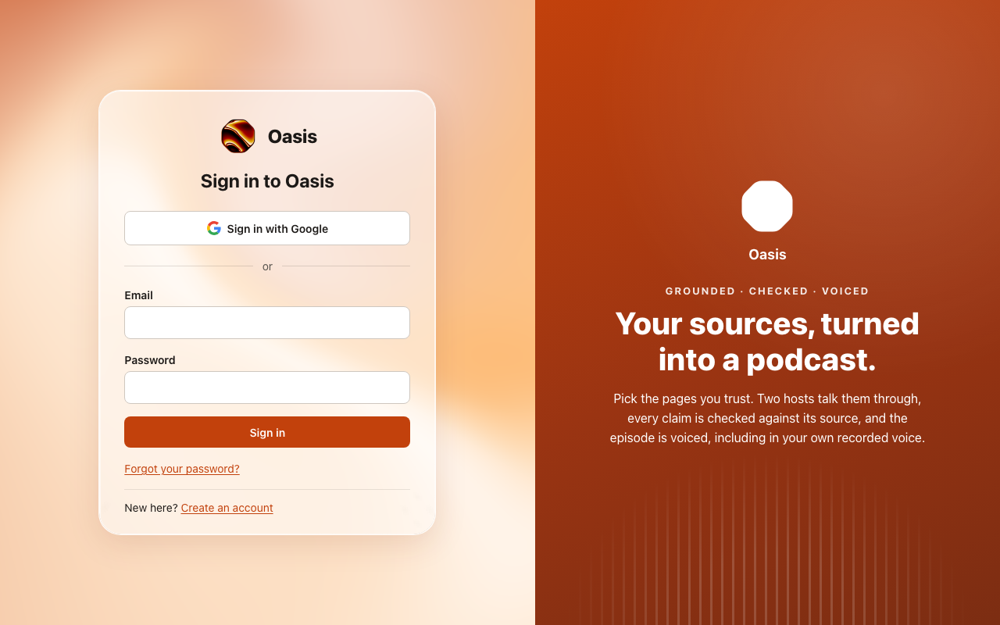
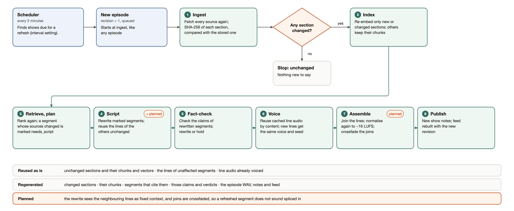
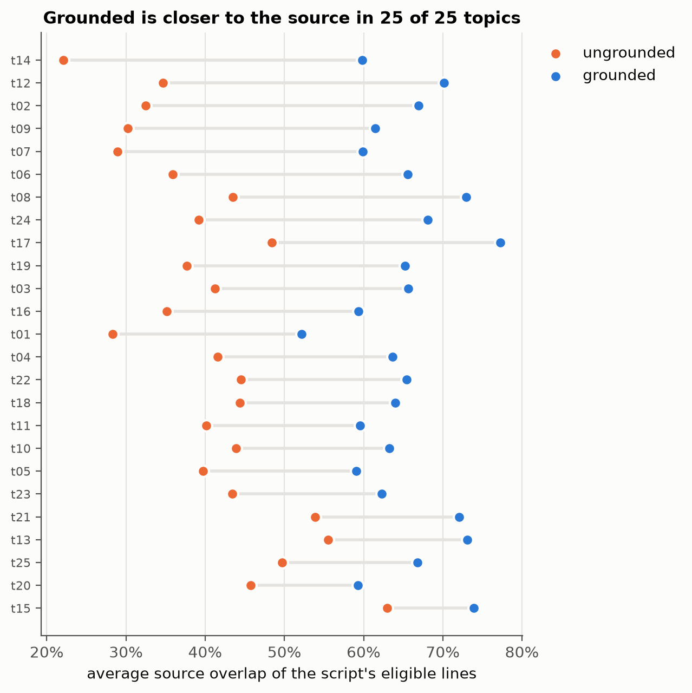
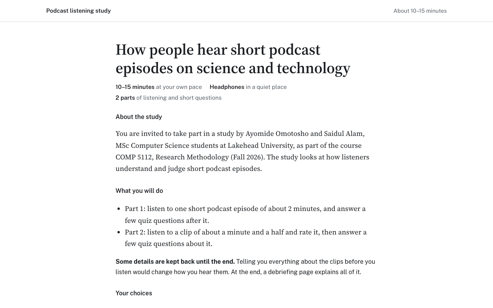
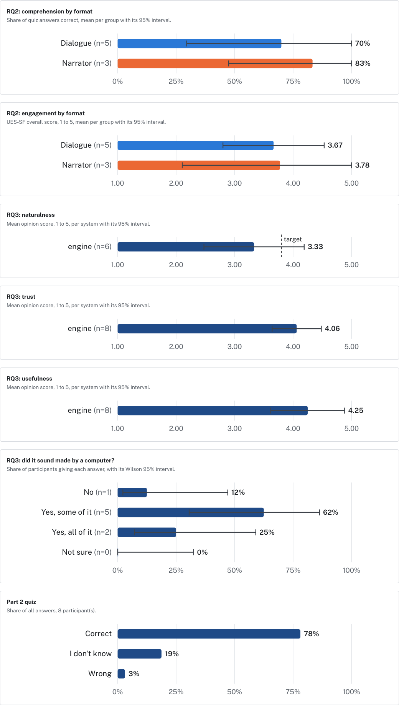
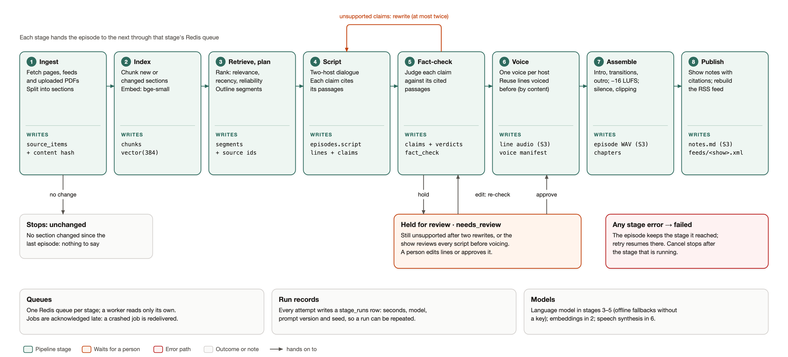
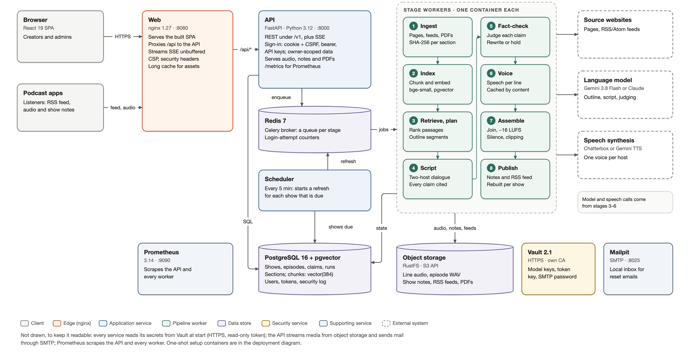

# Oasis: AI-Powered Podcast Creation with Dynamic Content

A research project for COMP 5112 (Research Methodology, Lakehead University, Fall 2026). It asks
whether an AI system can turn live, changing sources into podcast episodes that are **accurate**,
**understandable** and **trusted**. It answers through design science: we built the system, Oasis,
then evaluated it with three experiments and a refresh experiment.

Oasis takes the web pages, feeds, PDFs and searches a creator trusts. It writes a two-host
conversation in which every factual claim cites the passage it comes from, and checks each claim
against its source. It voices the episode, in the creator's own recorded voice if they wish, and
publishes it with show notes and an RSS feed. When a source changes, only the segments built from
it are regenerated.



## Research

### Problem

About 1 in 6 people live with a disability, and audio can open written knowledge to people who
find print hard to use. But podcasts with sources are slow to make and go stale. Read-aloud tools
don't produce a sourced, conversational show. Language models can invent facts. Script and speech
quality are well studied, and tools such as NotebookLM already turn documents into two-host audio.
Whether grounding, claim checks and refresh make such a podcast accurate and trusted is much less
tested.

### Research questions

| | Question | Design | Measures |
|---|---|---|---|
| **RQ1** · Accuracy | Does retrieval-grounded script generation make podcast scripts more factually accurate than ungrounded generation? | Grounded vs ungrounded scripts, same topics, same model, matched prompts | Claim accuracy, unsupported-claim rate, citation coverage; two blind raters, Cohen's kappa, paired test by topic |
| **RQ2** · Comprehension | Does a multi-host dialogue improve listener comprehension and engagement over a single narrator? | Same content as two hosts or one narrator; between subjects | Quiz score, UES-SF engagement, completion; t-test or Mann–Whitney U, effect sizes |
| **RQ3** · Perception | How do listeners rate AI-generated episodes on naturalness, trust and usefulness? | Blind listening test, origin disclosed at debriefing | ITU-T P.800 naturalness, message credibility, usefulness (1–5), perceived origin, comments |
| **Refresh claim** | Does a change in a source regenerate only what it touches? | One PDF, one number changed: refresh vs full rebuild | Segments regenerated, words kept, audio re-voiced, requests, time |

### Method

Design science (Hevner et al., 2004; Peffers et al., 2007): the research questions need a working
artifact and evidence about it. The project moved through eight phases:

1. **Research:** literature on retrieval-augmented generation, podcast and dialogue generation, neural
   TTS and evaluation; the research gap; the proposal.
2. **Requirements:** a PRD with functional requirements FR1–FR13 and non-functional targets
   (accuracy, generation time, cost, loudness of −16 LUFS).
3. **Prototype and ML:** one episode end to end in a notebook (embeddings, ranking, the fact-check
   gate), and voice cloning tested with Chatterbox.
4. **UI/UX design:** user journeys and wireframes, approved before any interface was built; WCAG 2.0 AA.
5. **Back end:** the API and the eight-stage pipeline.
6. **Front end:** the web app and the companion bot.
7. **Evaluation:** the studies below.
8. **Deployment:** Docker Compose locally, an AWS demo, and the listening study on Vercel and Supabase
   (data kept in Canada).


### Results so far

**Refresh claim (complete).** One number in one source PDF was changed and the show refreshed:

- **Segments:** 1 of 4 segments was rewritten.
- **Words kept:** 91% of the words a listener hears stayed the same, against 54% for a full rebuild.
- **Requests:** 2 Gemini text requests, against 5 for the rebuild.
- **Audio:** only 35 s of the 160 s episode was voiced again.



**RQ1 (scripts made and explored).** 25 topics, each written twice by
Claude Sonnet 5.5 with the same settings, for $4.01 in total.

- **Overlap with the source:** in all 25 topics, the grounded script's lines are closer to the
  source than the ungrounded script's. The median overlap per line is 73% against 40%.
- **Not just page length:** overlap rises with page length, but the gap between conditions does not
  (ρ = −0.13), so comparisons are paired by topic.
- **Next:** two blind raters are labelling sampled lines for accuracy, and their agreement will be
  reported as Cohen's kappa.



**RQ2 and RQ3 (pilot).** We had a problem getting a survey deck that allows audio survey so we built ours for the sake of this project. The online listening study is live: it contains one episode in Part 1, one clip in Part 2, two quizzes, then a debriefing. As of 25 November 2026,
54 people had finished and kept their answers:

| The study's information letter | The results dashboard |
|---|---|
|  |  |

### Limitations

- **Refresh experiment:** one document, one change and one run per condition. It is a case, not a
  distribution.
- **RQ1:** overlap measures wording, not accuracy, until the ratings are in. It covers one domain,
  ClickHouse documentation.
- **RQ2 and RQ3:**
  - Pilot sample sizes.

## The system



```
ingest → index → retrieve_plan → script ⇄ factcheck → voice → assemble → publish
```

1. **Ingest** fetches web pages, RSS/Atom feeds, uploaded PDFs and search results (Wikipedia, or Brave).
   It splits them into sections, each with its own content hash and anchor, so each can change and
   be cited on its own.
2. **Index** chunks the sections into 80-word windows with a 40-word overlap and embeds them in
   pgvector.
3. **Retrieve and plan** ranks passages by relevance, recency and source reliability, and plans the
   segments.
4. **Script** writes the two-host dialogue; every claim cites its passages.
5. **Fact-check** judges each claim against its passages (LLM judge, or word overlap offline).
   Unsupported claims send the segment back for a rewrite, up to `MAX_REWRITES`. After that, the
   episode is held for human review.
6. **Voice** gives each host a voice: Gemini's prebuilt voices, or a consented clone of a recorded
   voice (Chatterbox). Unchanged lines are reused from the cache.
7. **Assemble** applies host effects, the intro, outro, sting and music bed, loudness of −16 LUFS, and
   silence and clipping checks.
8. **Publish** writes the show notes with numbered citations and the RSS feed. Both carry an
   AI-generated label.

Every stage has its own queue and retries on its own. Workers are stateless: they pass only the
episode id, and keep state in Postgres and object storage. Each stage run records the model that
answered, the prompt version, the seed and its time, so every episode can be reproduced.



**Stack:**

| Part | Technology |
|---|---|
| Back end | Python 3.12+, FastAPI, Celery on Redis |
| Data | Postgres with pgvector, S3-compatible storage (RustFS) |
| Secrets | HashiCorp Vault over TLS |
| Front end | React and TypeScript (Vite), served by nginx |
| Monitoring | Prometheus metrics and structured JSON logs |
| Models | Gemini or Claude for writing; Gemini TTS or Chatterbox for voices |

**Ethics and safety:**
- **Labelling:** every episode is labelled AI-generated in its audio, notes and feed.
- **Cloned voices:** they need a signed consent form, stored verbatim with the recording. Deleting a
  voice withdraws consent and deletes its audio.
- **Accounts:** sign-in uses HttpOnly cookies with CSRF tokens, Argon2id password hashes, per-account
  and per-address limits, and a security log.

### Layout

```
src/podcast_engine/   api/ (routers, controllers, services, models, repositories), stages/<stage>/,
                      common/ (settings, queue, storage, LLM, quota), scheduler/, worker.py, pipeline.py
web/                  React + Vite web app
db/                   schema and migrations
prompts/              versioned prompts (<name>.v<N>.md), logged per episode
config/               source reliability tiers, pronunciation lexicon, voice registry
docs/                 api.md, erd.md, observability.md, diagrams/, images/
infra/demo/           the AWS demo (Terraform)
tests/                unit and integration tests
research/             git-ignored, local only: proposal, PRD, presentation, notebooks, and the
                      RQ1–RQ3 evaluation code, study app and results (make -C research help)
```

## Running it

```bash
make secrets        # creates .env and empty secrets/*.txt; add keys there, set passwords in .env
make up             # the whole stack: web app :8080, API :8000, Prometheus :9090
make check          # ruff, strict mypy and the unit tests (what CI runs)
```

On a fresh stack, the web app at http://localhost:8080 asks you to create the first account, the
admin. Then:

1. Create a show: its topic, style, hosts, and the pages, feeds, PDFs or searches to draw on.
2. Generate an episode and follow it stage by stage.
3. Review the script and its fact-check verdicts, edit lines, and approve it.
4. Listen, read the show notes, or refresh the episode when a source changes.

The API is documented at `/docs` and in [docs/api.md](docs/api.md); the data model is in
[docs/erd.md](docs/erd.md).

| Setting (`.env`) | Default | |
|---|---|---|
| `LLM_ENABLED` | `false` | `false`: the offline extractive writer and word-overlap judge, at no cost. `true`: Gemini or Claude plan, write and judge |
| `TTS_BACKEND` | `placeholder` | `gemini` for prebuilt voices; `chatterbox` for cloned voices, run on the host with `make voice-host` (it needs a GPU, which Docker on a Mac cannot reach) |
| `LLM_REQUESTS_PER_DAY`, `TTS_REQUESTS_PER_DAY` | `0` | A daily budget per Gemini model, so an episode starts only if the day can finish it (`python -m podcast_engine.common.quota` shows today's counts) |
| `MAX_REWRITES` | `2` | Fact-check rewrites before an episode is held for review |
| `REFRESH_INTERVAL_HOURS` | `0` | Automatic refresh of published shows; `0` is off (use the Refresh button) |
| `SEARCH_PROVIDER` | `wikipedia` | `wikipedia` (no key), `brave` (paid) or `off` |

API keys live in HashiCorp Vault. The files in `secrets/` only seed it:
`make rotate-secret NAME=llm_api_key` replaces a key. `make demo-site` starts a fictional local news
page whose story changes on demand, to demonstrate refresh. The AWS demo is described in
[infra/demo/README.md](infra/demo/README.md).

## References

- Hevner, March, Park and Ram (2004), design science in information systems research.
- Lewis et al. (2020), retrieval-augmented generation.
- Min et al. (2023), FActScore: claim-level factuality.
- ITU-T P.800 (1996), methods for subjective determination of transmission quality.
- O'Brien, Cairns and Hall (2018), the User Engagement Scale short form.
- Braun and Clarke (2006), thematic analysis.
