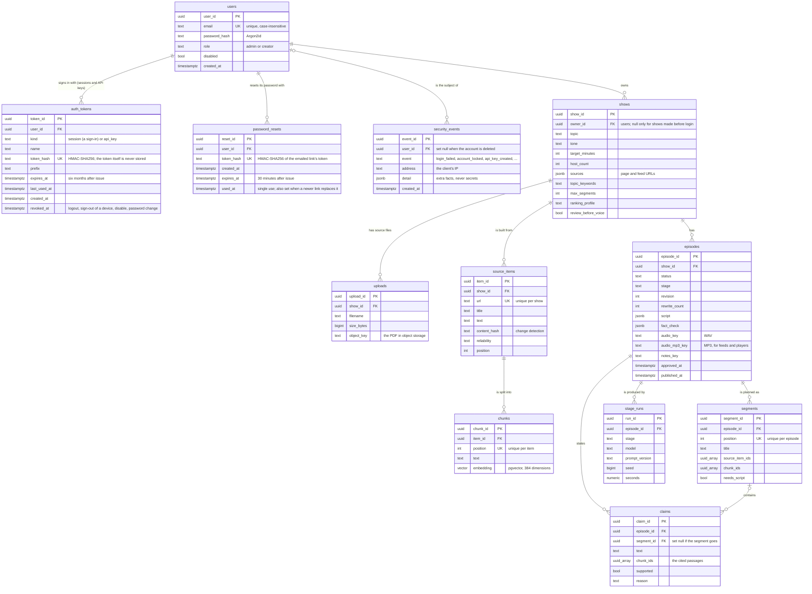

# Data model (ERD)

Postgres holds every record the API and the pipeline share. The schema is `db/init/` plus
`db/migrations/0003` to `0008`. This diagram was checked against the foreign keys in a migrated
database.

## Accounts, sign-ins and the security log

- **A session is a sign-in:** one browser or device that logged in. Sessions and API keys are both
  rows in `auth_tokens`, told apart by `kind`, because they authenticate the same way and share
  expiry and revocation. `GET /auth/sessions` lists a user's active sessions; `DELETE
  /auth/sessions/{token_id}` ends one. Only an HMAC of each token is stored.
- **Password resets** are single-use, short-lived rows. Requesting a new link voids older ones.
- **The security log** (`security_events`) records sign-ins, failures, locks, throttling, resets,
  password and email changes, API keys and account changes. It is append-only. When an account is
  deleted its entries stay, with `user_id` set to null; the deletion entry itself names the
  account in `detail.account`. Failed logins for unknown emails have no `user_id` and only a hash
  of the email.

## Ownership

**A show belongs to one user** (`shows.owner_id`), and everything else hangs off a show by foreign
key:

- uploads and source items belong to a show;
- chunks belong to a source item;
- episodes belong to a show;
- segments, claims and stage runs belong to an episode.

So one owner column decides who can reach every record, and there is no second copy of ownership
to drift out of step.

- **The API scopes every protected query to the caller.** Shows filter on `owner_id`. Episodes,
  sources and uploads are reached through a show the caller owns. Another user's record answers
  404, exactly like one that does not exist, so ids cannot be probed.
- **Admins are no exception.** An admin manages accounts but sees only their own shows.
- **Public by design:** episode audio, show notes, feeds and uploaded PDFs. Podcast apps and
  listeners fetch them without logging in, by URLs that carry random ids.
- **Shows made before login existed** have no owner. The first account to register (the admin)
  takes them over. The API never creates a show without an owner, and never shows an unowned one.

## Deleting

Deletes cascade down the tree:

- **Deleting a user** deletes their tokens, reset links and shows, and unlinks (keeps) their
  security log entries.
- **Deleting a show** deletes its uploads, source items (and their chunks) and episodes.
- **Deleting an episode** deletes its segments, claims and stage runs.

Files in object storage (WAV and MP3 audio, notes, feeds, uploaded PDFs) are removed by the API's
delete endpoints for episodes, uploads and accounts (`DELETE /auth/me`, `DELETE
/auth/users/{user_id}`). Deleting a show, or deleting anything through SQL directly, leaves those
files behind.
